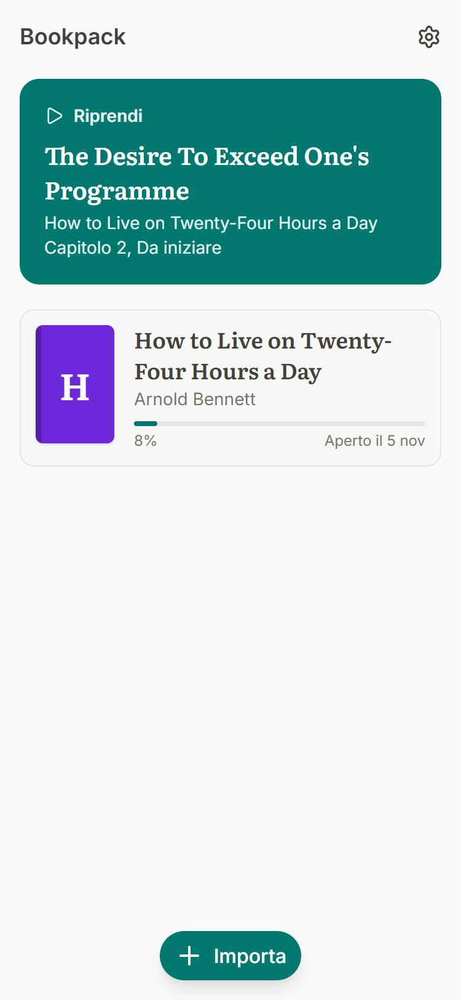
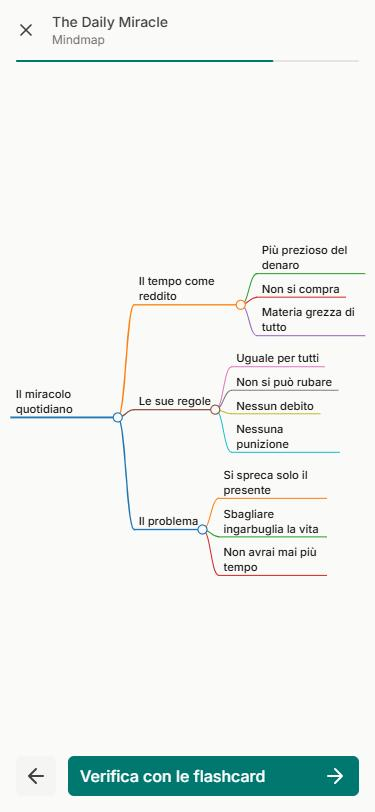
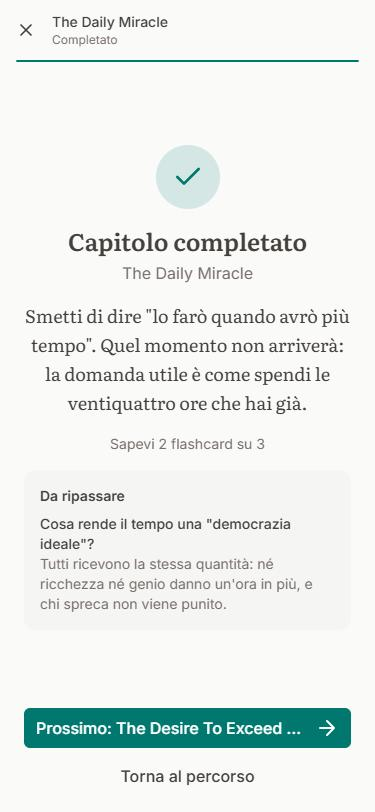
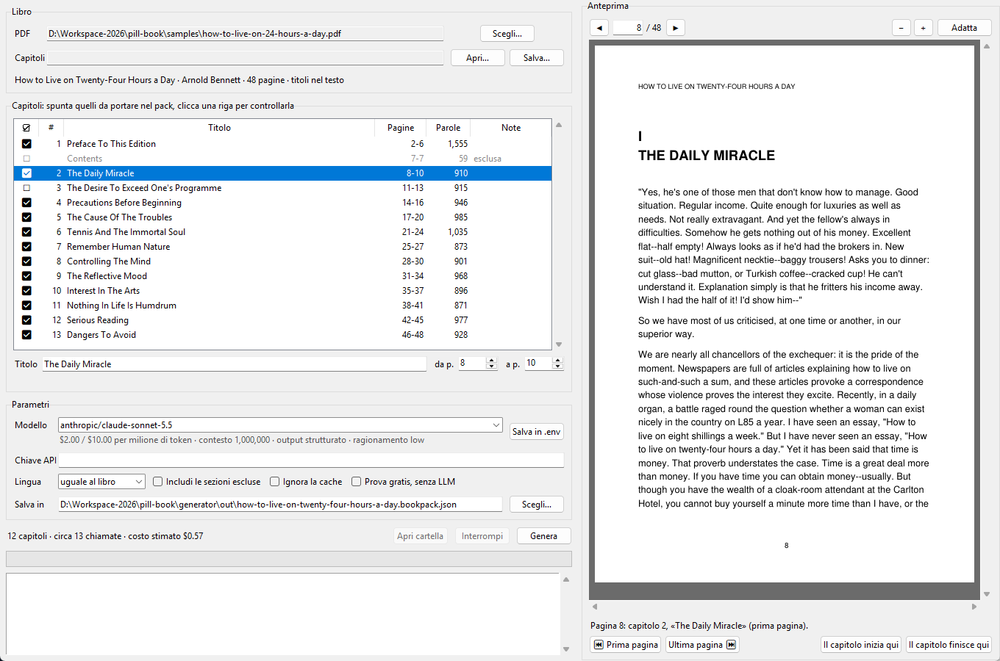

# Bookpack

Trasforma un PDF in un percorso di studio per il telefono. Ogni capitolo diventa una serie di card che spiegano il perché e il come, con domande durante la lettura, un riassunto finale, una mindmap e flashcard che tornano nel ripasso nei giorni successivi. Lo spazio cresce con la lunghezza del capitolo, e la forma si adatta al contenuto: i manuali tecnici hanno procedure passo per passo e comandi. Il progresso resta salvato e l'app funziona offline.

<p>
  
  
  
  
  
  
  
  
  
</p>

Il repo contiene due progetti che comunicano solo tramite un file `*.bookpack.json`, validato da uno schema condiviso:

- **`generator/`**: CLI e finestra Python che leggono il PDF e lo condensano con qualsiasi modello di [OpenRouter](https://openrouter.ai/models). Qui c'è tutta l'AI.
- **`web/`**: PWA statica in Nuxt, senza backend. I dati restano nel browser.

Lo stato delle milestone e ciò che non è ancora stato verificato sono in [docs/status.md](docs/status.md).

## Requisiti

[uv](https://docs.astral.sh/uv/) e [pnpm](https://pnpm.io/), con Node 24. Python 3.12 lo installa uv.

## Provare il lettore

```bash
cd web
pnpm install
pnpm dev
```

Apri http://localhost:3000 e scegli **Prova l'esempio**: è *How to Live on 24 Hours a Day* di Arnold Bennett, in italiano, con 12 capitoli.

## Generare un libro

```bash
cd generator
uv sync
cp .env.example .env
```

Nel file `.env` metti la tua chiave e il modello che preferisci:

```bash
OPENROUTER_API_KEY=sk-or-...
BOOKPACK_MODEL=anthropic/claude-sonnet-5.5
```

La chiave si crea su [openrouter.ai/keys](https://openrouter.ai/keys). Il modello può essere uno qualsiasi del catalogo; `uv run bookpack models sonnet` li cerca e ne mostra i prezzi.

### Con la finestra

```bash
uv run bookpack gui
```

1. Scegli il PDF. Cliccando un capitolo vedi a destra le sue pagine, così controlli che inizi e finisca dove deve.
2. Se un confine è sbagliato, correggilo: sfoglia fino alla pagina giusta e premi **Il capitolo inizia qui** o **finisce qui**, oppure scrivi i numeri di pagina.
3. Togli la spunta ai capitoli che non vuoi nel pack.
4. Scegli modello e lingua, guarda il costo stimato e premi **Genera**. Chiave e modello si possono inserire anche da qui.
5. Se ti fermi con **Interrompi** o qualcosa fallisce, **Riprendi** continua da dove eri, anche riaprendo il PDF in un secondo momento.



### Da riga di comando

**1. Controlla la divisione in capitoli e il costo stimato.** Questo comando non usa l'LLM.

```bash
uv run bookpack inspect ../books/libro.pdf
```

**2. Se serve, correggi la divisione a mano.**

```bash
uv run bookpack toc ../books/libro.pdf -o out/libro.toc.yaml
```

**3. Prova su pochi capitoli.** Mostra la stima e chiede conferma prima di spendere.

```bash
uv run bookpack build ../books/libro.pdf --toc out/libro.toc.yaml --chapters 1-2 --lang it
```

**4. Genera il libro intero.** Partono fino a 4 chiamate insieme; `--workers` cambia il numero.

```bash
uv run bookpack build ../books/libro.pdf --toc out/libro.toc.yaml --lang it
```

Se qualcosa fallisce, o premi Ctrl+C, le risposte già ottenute restano in cache e non si ripagano. Si riprende così, con gli stessi parametri:

```bash
uv run bookpack resume out/libro.state.json
```

**5. Importa il file.** Apri `/import` nell'app e carica `generator/out/<id>.bookpack.json`.

Per provare la pipeline gratis aggiungi `--fake` a `build`, o spunta **Prova gratis** nella finestra: il risultato è meccanico e serve solo a controllare che tutto funzioni.

## Costi

Costi **stimati** con i prezzi attuali del catalogo di OpenRouter:

| Modello | Saggio breve (48 pagine, 12 capitoli) | Manuale lungo (417 pagine, 16 capitoli) |
|---|---|---|
| `anthropic/claude-opus-5.5` | $2,12 | $5,55 |
| `anthropic/claude-sonnet-5.5` (default) | $1,06 | $2,78 |
| `openai/gpt-5.6-luna` | $0,13 | $0,32 |
| `anthropic/claude-haiku-5.5` | $0,05 | $0,14 |

La stima appare prima di ogni generazione e si aggiorna con il modello scelto. Alla fine viene mostrato il costo effettivo comunicato da OpenRouter. Il riscontro reale finora è solo su `~deepseek/deepseek-flash-latest`: il saggio breve è costato $0,05, come stimato, con meno output del previsto. La qualità dei vari modelli non è stata confrontata: conviene partire da `--chapters 1-2`.

## Libri e copyright

Nel repo vanno solo libri e pack di pubblico dominio. `books/` e `generator/out/` sono in gitignore: i pack generati da libri sotto copyright sono per uso personale.

## Licenza

Il codice è distribuito con licenza [MIT](LICENSE). La licenza non riguarda i libri da cui si generano i pack.

## Sviluppo

```bash
cd generator && uv run pytest && uv run ruff check .
```

```bash
cd web && pnpm lint && pnpm typecheck && pnpm test
```

Dopo un cambio del formato:

```bash
cd generator && uv run bookpack schema
```

```bash
cd web && pnpm gen:types
```

La documentazione completa è in [docs/](docs/README.md): [architettura](docs/architecture.md), [formato](docs/bookpack-format.md), [generatore](docs/generator.md), [lettore e deploy](docs/web.md), [decisioni](docs/decisions.md). Il piano originale è in [PLAN.md](PLAN.md).
